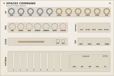

# Grandsummoner Spaces Command

> **38 HP Dual-Scene Probabilistic CV/Gate Sequencer & Arpeggiator**

<p align="left">
  
</p>

---

## Overview

**Spaces Command** is the 38 HP flagship composition and sequencing centerpiece of the Grandsummoner module family for [VCV Rack v2](https://vcvrack.com/). Engineered for generative exploration and live performance, Spaces Command houses two fully independent probabilistic sequence scenes (**Scene A** and **Scene B**) linked by a massive central **MORPH** crossfader and an autonomous motion engine.

With dual independent pitch and gate voice outputs (`VOICE 1` and `VOICE 2`), Spaces Command can simultaneously drive lead melodies, walking basslines, and polyphonic chord strums. It pairs deep generative algorithms (probabilistic step gates, Brownian pitch walks, micro-strumming, and mutational performance pads) with hands-on immediate playability.

---

## The Grandsummoner Module Family

Spaces Command acts as the master compositional brain of the **Grandsummoner Eurorack Family**:

| Module | Width | Primary Function | Role in Ecosystem |
| :--- | :--- | :--- | :--- |
| **Spaces Command** | 38 HP | Dual-Scene Probabilistic CV/Gate Sequencer & Arpeggiator | Master Composition & Clock Brain |
| **Beams** | 18 HP | Quad Algorithmic Euclidean Drum Engine & Sampler | Rhythm, Percussion & Clock Sync |
| **Stellar** | 14 HP | Dual-Voice Multi-Model Synthesizer Companion | Primary Melodic & Harmonic Voice |
| **Intel** | 14 HP | Modulation Matrix, Dual FX Engine & Metering Ladder | Utility, Inter-Module Modulation & Modulation Router |
| **Explorer** | 12 HP | Tape-Cloud Delay, Diffusion Reverb & Octave Shimmer | Master Spatialization, Diffusion & Ambient Textures |

### Shared Design Language
Every Grandsummoner module follows an authentic studio instrument aesthetic:
- **Warm Sand Cards** (`#F5F1E9` down to `#EDE7DC`) framed by precision `0.4–0.5pt` bronze perimeter cards (`#8A7F6A`).
- **Tactile Color-Coded Scenes**: Scene A accents in rich Brass/Gold (`#B8720A`), while Scene B accents in deep Maroon (`#8A2A2A`).
- **Performance Flash Indicators**: Distinct illuminated indicators for octave shifting, scene focus, and generative mutations.
- **Micro-Dots & Precision Scales**: Calibrated scales across faders, knobs, and routing matrices.

### Standalone vs. Family Operation

- **100% Standalone**: Spaces Command requires no special environment. It accepts standard external Eurorack clock, reset, 1V/Oct pitch, velocity, and morph CV, outputting calibrated 1V/Oct CV and gate signals.
- **Universal Adjacency Link**: Side connector LEDs (`LINK L` and `LINK R`) light up whenever Spaces Command is positioned adjacent to any Grandsummoner family module (**Intel**, **Stellar**, **Beams**, or **Explorer**).

### Cross-Module Synergies & Expander Bus
- **With Stellar (Dual Voice Pairing)**: Spaces Command's dual voice architecture is tailor-made for Stellar. Connect `VOICE 1 PITCH/GATE` to Stellar's Voice 1 and `VOICE 2 PITCH/GATE` to Stellar's Voice 2 for instant multitimbral arrangements.
- **With Intel (Invisible Expander Modulation)**:
  - When Intel sits anywhere in a contiguous chain with Spaces Command, Intel's four modulation channels invisibly modulate Command's **RATE**, **DENSITY**, **SWING**, and **ENTROPY** without cables.
  - Built-in intelligent floor protection prevents modulation from stalling the sequence or muting all gates.
- **With Beams**: Send Spaces Command's clock out to Beams, or drive Spaces Command from Beams' master tempo grid for tightly locked drum-and-synth grooves.
- **With Explorer**: Send Voice 2 gate triggers to Explorer's `FREEZE` jack to capture and hold ambient clouds at specific musical cadences.

---

## User Guide & Controls

```
┌────────────────────────────────────────────────────────────────────────────────────────┐
│                               SPACES COMMAND  38 HP                                    │
│                                                                                        │
│  I/O: (CLOCK) (RESET) (VOCT) (VEL) (MORPH CV) (SCENE CV) [V1 P] [V1 G] [V2 P] [V2 G]   │
│                                                                                        │
│  PERFORMANCE CONTROLS:                                                                 │
│  [SCENE A] [SCENE B] [LATCH] [ARP/SEQ] [STRUM] [FREEZE] [ROUTING] [-OCT] [+OCT]       │
│                                                                                        │
│  PROBABILISTIC STEP FADERS (STEPS 1–8):                                                │
│  |   |   |   |   |   |   |   |   (Each fader sets 0–100% step hit probability)         │
│  [1] [2] [3] [4] [5] [6] [7] [8] (Step active toggle buttons)                          │
│                                                                                        │
│  GENERATIVE MUTATION PADS:                                                             │
│  [MELO] (pitch shifts)  [ARTI] (gate/tie/strum)  [TIME] (swing/speed)  [NAVY] (invert) │
│                                                                                        │
│  CENTRAL CROSSFADER & MOTION:                                                          │
│  ◄ [================== MORPH SLIDER ==================] ►                              │
│  [AUTO SPEED]  [WALK]  [ROAM]                                                          │
└────────────────────────────────────────────────────────────────────────────────────────┘
```

### 1. I/O & Routing (Top Left & Top Right)
- **CLOCK Input**: External tempo input (threshold +1.5V). When unpatched, engine runs off internal rate generator.
- **RESET Input**: Resets sequencer playheads to step 1 on rising edge.
- **VOCT Input (1V/Oct)**: Pitch tracking input for ARP mode or transposing SEQ patterns.
- **VELOCITY Input (0–10V)**: Dynamic velocity input for scaling output gate dynamics.
- **MORPH CV Input (±5V)**: Voltage control over the central MORPH crossfader position.
- **SCENE CV Input (Trigger)**: Toggles focus between Scene A and Scene B.
- **VOICE 1 PITCH & GATE**: Calibrated 1V/Octave CV and +10V gate outputs for primary voice.
- **VOICE 2 PITCH & GATE**: Secondary pitch and gate outputs for bassline, counterpoint, or harmony.

### 2. Scene Architecture & Morphing
- **SCENE A / SCENE B Buttons**: Selects which scene is currently being edited on the panel.
- **MORPH Slider**: Continuous high-resolution crossfader interpolating between Scene A and Scene B (probabilities, note distributions, swing, and density).
- **AUTO SPEED**: Sets rate of autonomous morphing motion.
- **WALK Mode**: Smooth bidirectional wandering between Scene A and Scene B.
- **ROAM Mode**: Random leaping and drifting between scenes for unpredictable generative transitions.

### 3. Step Faders & Step Buttons (1–8)
- **8 Probability Faders (0% – 100%)**: Sets the statistical trigger likelihood of each step. At 100%, the step triggers every cycle; at 50%, it triggers half the time; at 0%, it acts as a rest.
- **Step Buttons (1–8)**: Toggles the step active or muted.

### 4. Generative Mutation Pads
- **MELO**: Probabilistically permutes melody notes within the selected harmonic scale.
- **ARTI (Articulation)**: Randomizes gate lengths, introduces ties, and triggers chord strums.
- **TIME**: Injects groove swing and rhythmic subdivisions into the active pattern.
- **NAVY**: Flips step polarity and inverts melodic contours.

### 5. Performance Function Buttons
- **LATCH**: Holds notes playing indefinitely without requiring sustained keys or gates.
- **ARP / SEQ**: Toggles between chord-following Arpeggiator mode and independent Step Sequencer mode.
- **STRUM**: Introduces micro-delay strumming offsets across multi-note chords.
- **FREEZE**: Completely locks current sequence buffers into an unvarying loop.
- **ROUTING**: Cycles output voice allocation (Unison, Split, Alternating, or Polyphonic).
- **OCTAVE UP / DOWN**: Instant momentary transposition pads (±1 to ±3 octaves).

---

## Technical Specifications

- **Width**: 38 HP (193.04 mm)
- **Height**: 3U (128.5 mm physical standard / bit-for-bit 380px VCV grid height)
- **Depth**: 30 mm
- **Voice Outputs**: 2 independent 1V/Oct pitch CV + 10V gate channels
- **Step Resolution**: 8 steps per scene with polyphonic voice routing
- **Pitch Range**: -3V to +5V (8 octaves calibrated)
- **Internal DSP**: 64-bit precision floating-point engine

---

## Building and Installation

### Prebuilt Plugin Package
Download `SpacesCommand-2.0.0-<platform>.vcvplugin` from the [Releases](https://github.com/Grandsummoner/spaces/releases) section and copy it to your VCV Rack `plugins` directory:
- **Windows**: `Documents/Rack2/plugins/`
- **macOS**: `Documents/Rack2/plugins/`
- **Linux**: `~/.Rack2/plugins/`

### Building from Source
Ensure you have the [VCV Rack SDK v2](https://vcvrack.com/downloads/) installed.

```bash
# Clone the repository
git clone https://github.com/Grandsummoner/spaces.git
cd spaces

# Set your Rack SDK directory
export RACK_DIR=/path/to/Rack-SDK

# Build the distributable package
make -j2 dist
```

The compiled package will be located in `dist/SpacesCommand-2.0.0-<platform>.vcvplugin`.

---

## License

This software is released under the **GNU General Public License v3.0 or later** (GPL-3.0-or-later).  
Copyright © 2026 Grandsummoner. All rights reserved.
